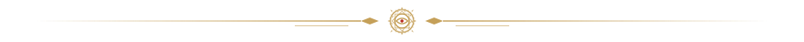
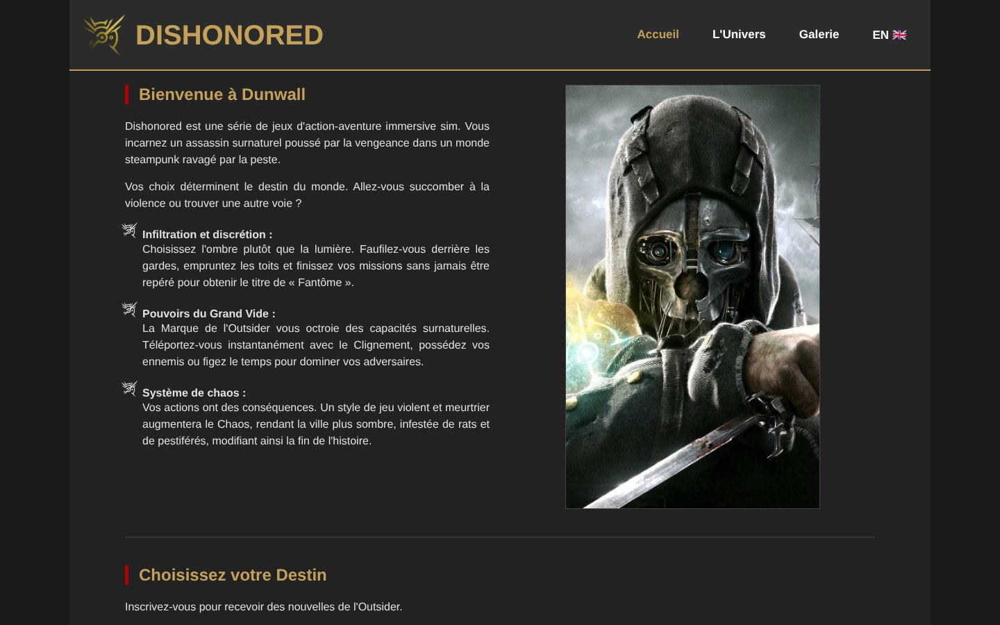
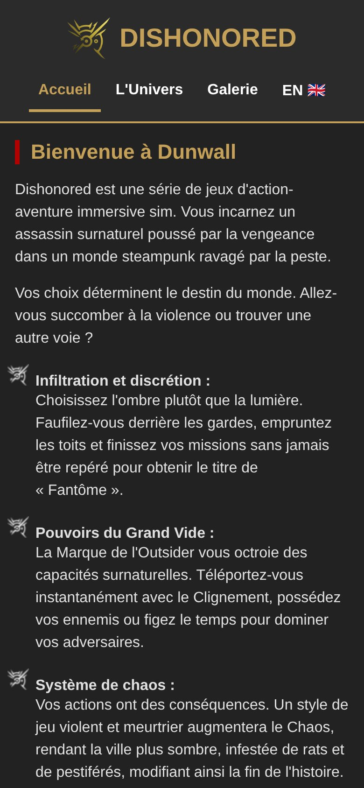

<a href="https://borism-afk.github.io/site-dishonored/">
  <picture>
    <source media="(prefers-color-scheme: dark)" srcset="docs/banner-dark.svg">
    <source media="(prefers-color-scheme: light)" srcset="docs/banner-light.svg">
    
  </picture>
</a>

<p align="center">
  <a href="https://borism-afk.github.io/site-dishonored/"></a>
  
  
  
  <br>
  
  
  
</p>

<p align="center">
  <b><a href="https://borism-afk.github.io/site-dishonored/">Voir le site en ligne</a></b>
  &nbsp;·&nbsp;
  <a href="https://borism-afk.github.io/site-dishonored/langues/en/home.html">English version</a>
  &nbsp;·&nbsp;
  <a href="https://miletic-boris.fr">Portfolio de Boris Miletic</a>
</p>

> *« Le présent registre consigne la construction d'un site consacré à Dunwall et à l'Empire des Îles. Toute ressemblance avec un document officiel de la Couronne serait fortuite : il s'agit d'un travail d'étudiant. »*\
> — Archives de la Garde de la Ville, pièce n° 1

<p align="center"></p>

## Sommaire

- [Aperçu](#aperçu)
- [Les pages du site](#les-pages-du-site)
- [Le dossier de l'enquêteur](#le-dossier-de-lenquêteur)
- [Technologies](#technologies)
- [Structure du projet](#structure-du-projet)
- [Lancer le site en local](#lancer-le-site-en-local)
- [Note légale](#note-légale)
- [Crédits](#crédits)

<p align="center"></p>

## Aperçu

<table>
  <tr>
    <th>Ordinateur (1440 px)</th>
    <th>Téléphone (390 px)</th>
  </tr>
  <tr>
    <td align="center" valign="top"></td>
    <td align="center" valign="top"></td>
  </tr>
</table>

<p align="center"></p>

## Les pages du site

| | Français | English | Ce qu'on y trouve |
|:-:|---|---|---|
| I | [Accueil](https://borism-afk.github.io/site-dishonored/) | [Home](https://borism-afk.github.io/site-dishonored/langues/en/home.html) | Présentation du jeu, infiltration, pouvoirs, système de chaos et un formulaire « Choisissez votre Destin » |
| II | [L'Univers](https://borism-afk.github.io/site-dishonored/langues/fr/thematique.html) | [The Universe](https://borism-afk.github.io/site-dishonored/langues/en/thematic.html) | La Marque de l'Outsider, l'Empire des Îles, la technologie à l'huile de baleine et l'Abbaye du Quidam |
| III | [Galerie](https://borism-afk.github.io/site-dishonored/langues/fr/galerie.html) | [Gallery](https://borism-afk.github.io/site-dishonored/langues/en/gallery.html) | Dix images (personnages, Dunwall, Karnaca, le Grand Vide) avec fond flouté et effets au survol |

<p align="center"></p>

## Le dossier de l'enquêteur

> **DOSSIER N° 001 — CONFIDENTIEL**\
> **Objet :** un site web consacré à l'Empire des Îles\
> **Auteur :** Boris Miletic, étudiant en BUT MMI\
> **Statut :** en ligne, surveillé

**Pièce 1. Les faits.** Ce site est mon tout premier site en HTML et CSS, réalisé pour le module Web1 du BUT Métiers du Multimédia et de l'Internet. Il est consacré à l'univers de *Dishonored* : Dunwall, la peste, l'huile de baleine, l'Outsider et l'Empire des Îles.

**Pièce 2. Le mode opératoire.** Trois pages, déclinées en français et en anglais, toutes écrites à la main, sans framework ni JavaScript. La charte tient en trois couleurs : le noir de l'encre, l'or vieilli `#c5a059` et le rouge sang `#b10101`.

**Pièce 3. Les indices.** Quelques détails techniques :

- une lettrine dorée en début de paragraphe (`::first-letter`) ;
- une galerie où chaque image est posée sur une copie floutée d'elle-même (`filter: blur()` et `object-fit`) ;
- des effets de survol différents pour les cartes paires et impaires (`:nth-child`) ;
- des puces de liste remplacées par une icône (`list-style-image`).

**Pièce 4. La reprise de l'enquête.** En publiant le site sur GitHub Pages, je l'ai repris : il est maintenant responsive (de 320 à 1440 px), les contrastes ont été corrigés, les champs du formulaire sont plus faciles à remplir sur mobile et chaque page a son titre et sa description.

> *« Les rues changent, les toits restent. Qui connaît les toits connaît la ville. »*\
> — Note griffonnée en marge du dossier

<details>
<summary><b>Ce qui a changé pour la version en ligne</b></summary>

<br>

- `accueil.html` devient `index.html` (GitHub Pages sert `index.html`). L'ancienne adresse redirige vers la nouvelle.
- Balise `viewport` sur toutes les pages, largeurs fixes remplacées par `max-width`.
- Trois paliers de media queries (1100, 820 et 600 px) : le menu passe sous le titre et revient à la ligne, les colonnes s'empilent, la galerie passe de deux colonnes à une.
- Contrastes : la signature de la citation et le texte du pied de page sont plus clairs.
- Formulaire : `autocomplete` sur le nom et l'email, champs et boutons d'au moins 44 px de haut.
- Liens externes en `rel="noopener"`, `transition` sur des propriétés précises.
- Titres `<h1>` sur le sujet du site, `<title>` et `meta description` pour chaque page.
- Typographie française : espaces insécables avant les deux-points, guillemets « ».

</details>

<p align="center"></p>

## Technologies

| Outil | Usage |
|---|---|
| **HTML5** | Structure sémantique : `header`, `nav`, `main`, `section`, `article`, `aside`, `blockquote`, `form` |
| **CSS3** | Flexbox, media queries, `filter`, `object-fit`, `transform`, pseudo-éléments |
| **GitHub Pages** | Hébergement du site statique |

Aucune bibliothèque, aucun framework, aucun script : seulement deux feuilles de style (`reset.css` et `main.css`).

## Structure du projet

<details>
<summary><b>Voir l'arborescence</b></summary>

```text
site-dishonored/
├── index.html                  # Accueil (FR)
├── accueil.html                # Redirection vers index.html
├── explication-du-code.pdf     # Dossier d'explication du code
├── langues/
│   ├── fr/
│   │   ├── thematique.html     # L'Univers
│   │   └── galerie.html        # Galerie
│   └── en/
│       ├── home.html           # Home
│       ├── thematic.html       # The Universe
│       └── gallery.html        # Gallery
├── styles/
│   ├── reset.css
│   └── main.css
├── images/
│   ├── logo.png
│   ├── accueil/
│   ├── univers/
│   └── galerie/
└── docs/                       # Visuels du README
```

</details>

## Lancer le site en local

<details>
<summary><b>Deux façons de faire</b></summary>

<br>

**Le plus simple :** ouvrir `index.html` dans un navigateur.

**Avec un petit serveur local** (Python installé) :

```bash
git clone https://github.com/BorisM-afk/site-dishonored.git
cd site-dishonored
python -m http.server 8000
```

puis aller sur <http://localhost:8000>.

</details>

<p align="center"></p>

## Note légale

> [!NOTE]
> *Dishonored* est une marque d'**Arkane Studios** et de **Bethesda Softworks** (ZeniMax Media). Ce site est un **projet étudiant non officiel**, réalisé à des fins pédagogiques, sans but commercial et sans lien avec ces sociétés. Les images du jeu restent la propriété de leurs auteurs.
>
> Les visuels de ce README (bannière, sceau, séparateurs) sont des créations originales et ne reprennent aucun logo officiel.

## Crédits

Conception et intégration : **Boris Miletic**, étudiant en deuxième année de BUT MMI.\
Portfolio : [miletic-boris.fr](https://miletic-boris.fr)

<p align="center">
  <a href="https://miletic-boris.fr"></a>
</p>
